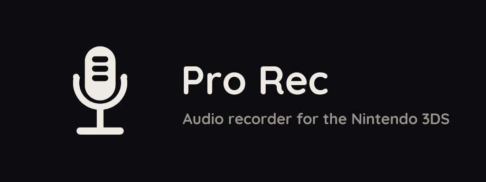
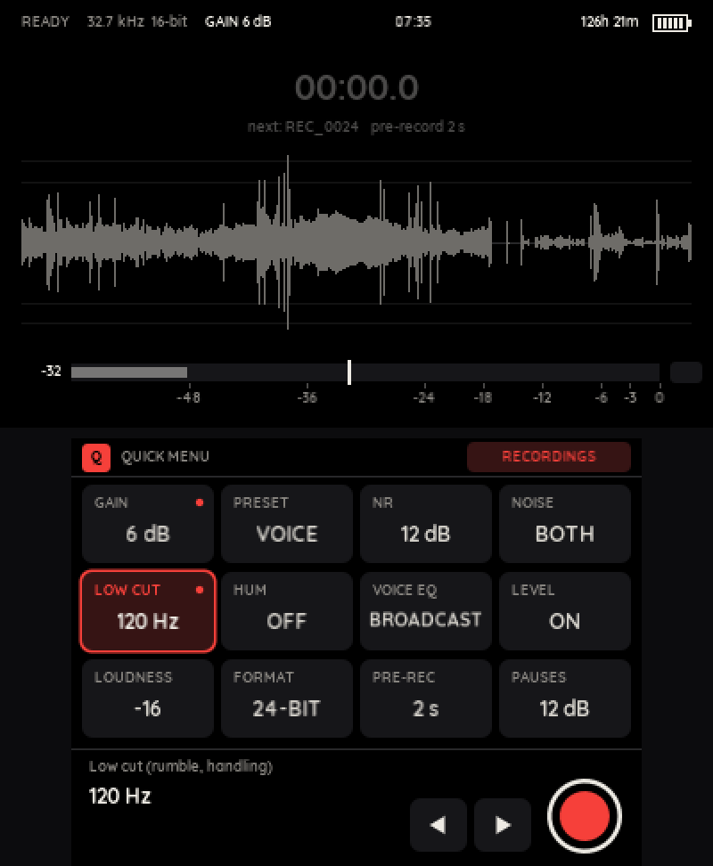
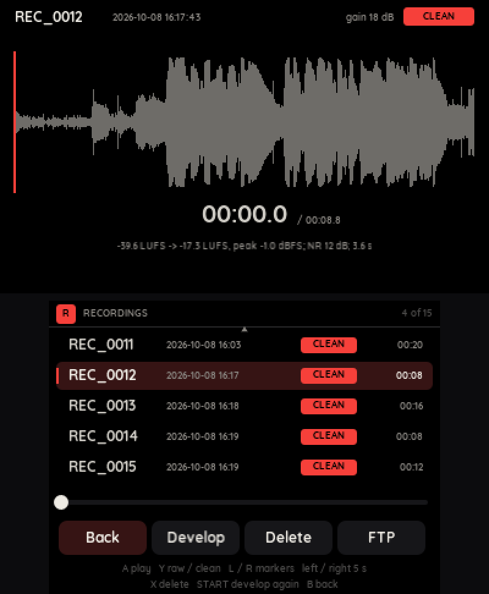
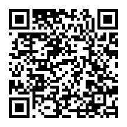

<p align="center"></p>

Record sound on your 3DS and clean it up.

<p align="center">
  
  
</p>

## Install

You need a 3DS with [Luma3DS](https://github.com/LumaTeam/Luma3DS).

1. Open FBI.
2. Choose Remote Install, then Scan QR Code.
3. Scan this code.



Or download `prorec.cia` from [Releases](https://github.com/3DS-Pro-Media-Suite/prorec/releases/latest) and install it with FBI.
For the Homebrew Launcher, copy `prorec.3dsx` to `sdmc:/3ds/`.

Playback needs `sdmc:/3ds/dspfirm.cdc`: run [DSP1](https://github.com/zoogie/DSP1/releases) once to get it.

## Features

- Records the mic at 32.7 kHz and keeps the raw file.
- Makes a clean copy with noise reduction, EQ and loudness levelling.
- Removes button clicks from the clean copy.
- Presets for voice, meetings, music and nature.
- Pre-record, self-timer, pause and markers.
- Live level meter, waveform and spectrum.

## Controls

| Button | Action |
|---|---|
| A, R or ZR | Start or stop recording |
| X | Pause or resume |
| L | Add a marker |
| Y | Headphone monitor on or off |
| Circle Pad up, down | Mic gain |
| SELECT | Recordings |
| START | Menu |
| START + SELECT | Exit |

To record, tap the red button at the bottom right of the touch screen.
Tap a setting, then tap it again to pick a value.

## Files

| What | Where |
|---|---|
| Raw takes | `sdmc:/Recordings/REC_nnnn_RAW.WAV` |
| Clean copies | `sdmc:/Recordings/REC_nnnn.WAV` |
| Date, gain, markers and develop settings of each take | `sdmc:/Recordings/REC_nnnn.TXT` |
| Settings and noise profiles | `sdmc:/3ds/prorec` |

FTP: open the menu, go to SYSTEM and tap FTP server. It has no password, so use a trusted network.

## Build

You need devkitPro with `3ds-dev` and `3ds-zlib`.

```sh
git clone --recursive https://github.com/3DS-Pro-Media-Suite/prorec
make        # prorec.3dsx
make cia    # prorec.cia, needs makerom and bannertool
```

The font and the icon live in `assets/`. Each folder has a script that rebuilds the file the app uses.

## License

MIT. The Quicksand font is under the SIL Open Font License. See `NOTICE`.
